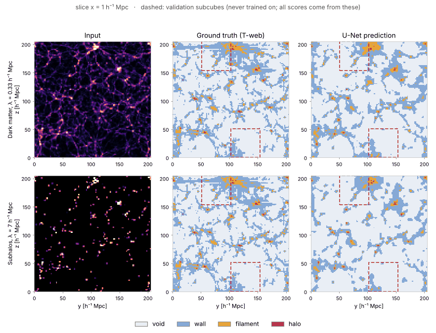
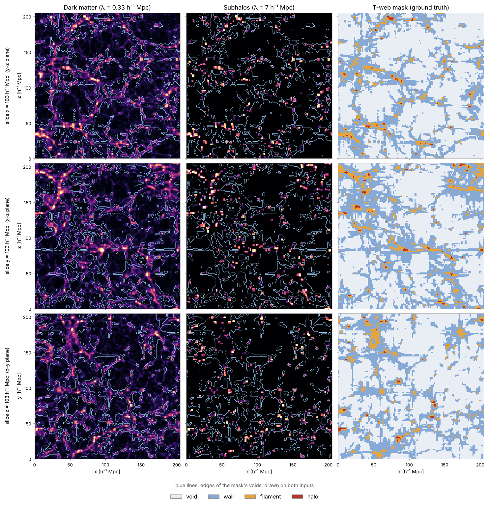
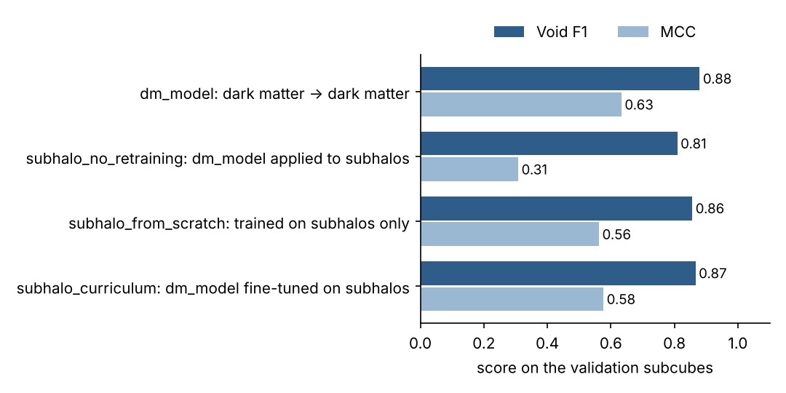
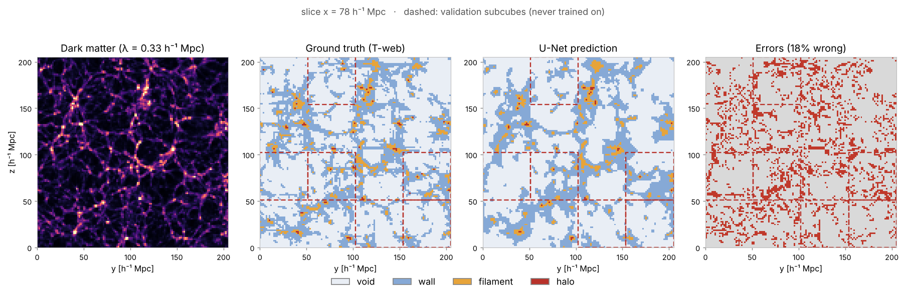
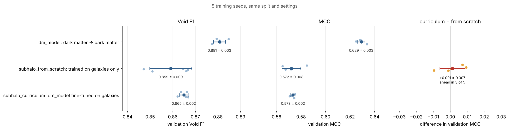
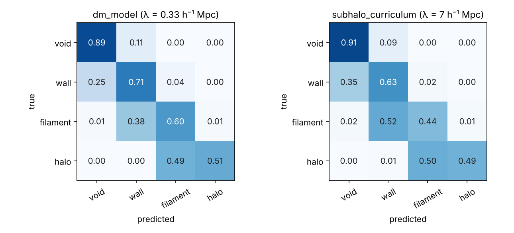
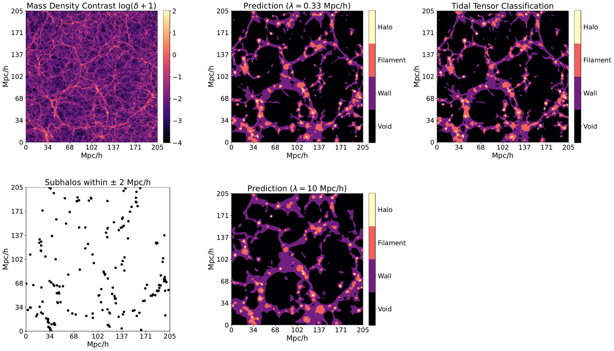
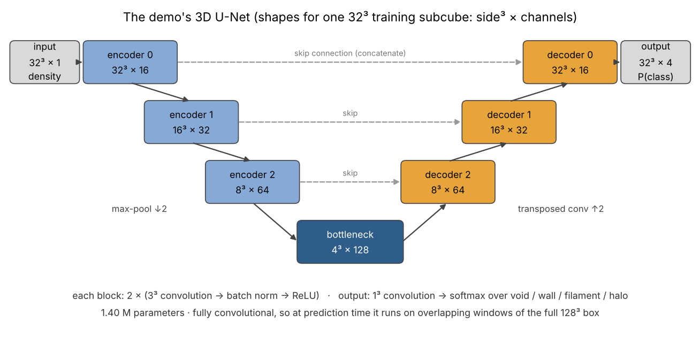

# DeepVoid demo: segmenting the cosmic web with a 3D U-Net

[](https://colab.research.google.com/github/skumagai3/deepvoid-demo/blob/main/notebooks/deepvoid_demo.ipynb)
[-1f4e79)](https://doi.org/10.3847/1538-4357/ae2c80)
[](https://arxiv.org/abs/2504.21134)

<p align="center">
  
</p>

<p align="center"><em>
Slices through the simulation box. Top row: predictions from the full dark matter density. Bottom row:
predictions from subhalos alone (about 10,000 times fewer tracers). The dashed squares are validation
subcubes that were held out of training.
</em></p>

DeepVoid is a 3D U-Net that labels every voxel of a cosmological simulation as void, wall, filament, or
halo. It was the main project of my PhD in physics at Drexel (2026) and is published in
*The Astrophysical Journal* ([Kumagai et al. 2026](https://doi.org/10.3847/1538-4357/ae2c80)).

This repo is a scaled-down version that runs in Colab in a few minutes. It includes trained weights, a
small sample of simulation data from the public [IllustrisTNG](https://www.tng-project.org/) project
(see [Simulation data](#simulation-data-illustristng) below), and a notebook that goes from a density
field to scored predictions.

## Background

On large scales, matter in the universe is arranged in a cosmic web. Most of the volume is taken up by
voids, which are surrounded by thin sheets (walls). The walls meet in filaments, and filaments meet at
dense halos, which is where galaxies form.

Voids are worth studying for a few reasons:

- Dark energy. Dense regions collapsed under their own gravity long before dark energy came to dominate
  the universe's expansion, so voids are the part of the cosmic web that dark energy has shaped most. To a first approximation, the
  accelerating expansion of the universe is the voids expanding and pushing the dense structures apart.
  Voids are also round on average, so if their shapes look stretched or squashed along our line of sight,
  the assumptions we used to turn redshifts into distances are off (the Alcock–Paczyński test).
- Gravity. Many alternatives to general relativity are built so that their effects stay hidden in dense
  places like our solar system, where gravity has been tested very precisely. That hiding doesn't work in
  near-empty regions, so voids are one of the few places those theories would show up, for example as
  voids that grow and empty out faster than standard gravity predicts.
- Isolated galaxies. Matter drains out of voids over time, and the few galaxies inside them live with
  very few neighbors. That makes voids a clean place to see how galaxies form and evolve on their own,
  without constant mergers and interactions.

The catch is that there is no agreed-upon definition of where a void begins and ends, and the common void
finders rely on choices that have to be tuned. [ZOBOV](https://arxiv.org/abs/0712.3049)
and [VIDE](https://arxiv.org/abs/1406.1191) build a cell around every galaxy and merge low-density cells
into voids, and the result depends on how those merges are cut off. [VoidFinder](https://arxiv.org/abs/astro-ph/0109357)
removes isolated galaxies, fills the space between the rest with empty spheres, and keeps only voids that
hold a sphere at least 10 h⁻¹ Mpc in radius. When [13 void finders were run on the same simulation](https://arxiv.org/abs/0803.0918),
they agreed on the largest void but disagreed on the smaller ones, on void sizes, and on which galaxies
count as void galaxies.

Instead of tuning another finder, I used a definition based on the physics that shapes the cosmic web:
the tidal tensor (T-web). At each point you compute the tidal field from
the smoothed matter distribution and count how many directions matter is collapsing along: zero means
void, one wall, two filament, three halo. The network only ever sees the density field and has to learn
to reproduce those labels.

<p align="center">
  
</p>

A few things make this harder than it might look:

- The data are 3D and large. The demo box is 128³ (2.1 million voxels) and the paper used 512³
  (134 million). Training is done on 32³ subcubes, and predictions for the full box are stitched together
  from overlapping windows so there are no seams.
- The classes are very unbalanced: voids are 62% of the volume and halos 0.5%. Predicting "void"
  everywhere would already give 62% accuracy, so I report void F1 and the multiclass Matthews
  correlation coefficient (MCC) instead.
- Real surveys see galaxies, not dark matter. Galaxies are a sparse and biased sample of the underlying
  matter, so the more realistic task is to recover the web of the full matter field from subhalos spaced
  7 to 10 h⁻¹ Mpc apart, where 93% of voxels are empty. In the paper I used curriculum learning for this:
  train on dark matter first, then adapt to sparser tracers. The demo compares a simplified, one-step
  version of that with training on subhalos from scratch.
- The validation set has to stay separate from training. The box is cut into 32³ subcubes and split into
  training and validation before any augmentation, so rotated copies only ever come from training
  subcubes. All the numbers below are computed on the validation subcubes.

## Results

### Models

| Model | Trained on | Applied to | What it tests |
|---|---|---|---|
| `dm_model` | dark matter (λ = 0.33 h⁻¹ Mpc) | dark matter | the basic task, using the full matter field |
| `subhalo_no_retraining` | dark matter | subhalos (λ = 7 h⁻¹ Mpc) | whether a dark matter model works on sparse tracers without retraining (inputs rescaled, weights unchanged) |
| `subhalo_from_scratch` | subhalos | subhalos | training directly on the sparse field from random weights |
| `subhalo_curriculum` | dark matter, then subhalos | subhalos | one-step curriculum: start from `dm_model`, freeze its first encoder block, fine-tune on subhalos (the paper uses two steps, see below) |

All four are scored against the same T-web labels, which are computed from the full dark matter. For the
subhalo inputs, that means the network has to infer structure it can't see directly.

### Scores

<!-- RESULTS:START (filled from results/metrics.json) -->
These are the published models (min-max normalization, overlapping training subcubes), scored on the
13 validation subcubes (425,984 voxels) that were never trained on. Validation loss was also used for early
stopping.

| Model | Void F1 | MCC | Balanced accuracy | Halo F1 |
|---|---|---|---|---|
| `dm_model` | 0.880 | 0.634 | 0.677 | 0.632 |
| `subhalo_no_retraining` | 0.810 | 0.309 | 0.384 | 0.364 |
| `subhalo_from_scratch` | 0.857 | 0.563 | 0.607 | 0.571 |
| `subhalo_curriculum` | 0.867 | 0.577 | 0.617 | 0.598 |
<!-- RESULTS:END -->

<p align="center">
  
</p>

<p align="center">
  
</p>

### Observations

Most of the errors are near misses. About half of the validation voxels sit on a boundary between two
classes, but 90% of `dm_model`'s errors are on those boundaries, and only 0.2% of its errors are off by
more than one class (void predicted as filament, for example). The confusion matrices further down show
the same pattern.

Going from dark matter to subhalos costs less than I expected. With about 10,000 times fewer tracers,
void F1 only drops from 0.88 to 0.86 or 0.87. A dark matter model doesn't carry over to subhalos without
retraining, though (`subhalo_no_retraining`, MCC 0.31), because the sparse field looks very different to
the network.

The curriculum and from-scratch models end up with the same average score. I retrained the published
configuration with 5 different random seeds (figure below): validation MCC is 0.573 ± 0.002 for the
curriculum model and 0.572 ± 0.008 from scratch, and the curriculum model is ahead in 3 of the 5 seeds.
It does vary about four times less from run to run, and it gets higher halo F1 in all 5 seeds (by 0.03 on
average), but 5 seeds aren't enough to call that significant. This is in line with the paper, where the
gain from the curriculum was also modest: at λ = 10 h⁻¹ Mpc, training directly on subhalos gave void
F1 = 0.89 and MCC = 0.56, and the best curriculum gave the same void F1 with MCC = 0.60.

One caveat: the demo uses a simplified, one-step curriculum (dark matter at λ = 0.33 straight to subhalos
at λ = 7 h⁻¹ Mpc, with the first encoder block frozen). The best scheme in the paper has two steps
(λ = 0.33 → 3 → 10 h⁻¹ Mpc, freezing more of the encoder at each step) and runs at 512³, where the tracers
are much sparser in voxel terms (about 25 voxels apart at λ = 10, compared with about 4 here). That is the
regime where pretraining on dense data should help most, and the demo doesn't test it.

<p align="center">
  
</p>

<p align="center">
  
</p>

<details>
<summary>All six training configurations (validation MCC; the published one is <code>minmax + overlap</code>)</summary>

| Model | minmax | log | log_zscore | minmax + overlap | log + overlap | log_zscore + overlap |
|---|---|---|---|---|---|---|
| `dm_model` | 0.616 | 0.616 | 0.622 | 0.634 | 0.637 | 0.622 |
| `subhalo_no_retraining` | 0.279 | 0.447 | 0.239 | 0.309 | 0.313 | -0.052 |
| `subhalo_from_scratch` | 0.542 | 0.517 | 0.542 | 0.563 | 0.551 | 0.566 |
| `subhalo_curriculum` | 0.544 | 0.523 | 0.536 | 0.577 | 0.548 | 0.548 |

Training on overlapping subcubes helped in almost every case, presumably because it gives more varied
training data. Changing the normalization or overlap moves the trained models by up to about 0.02 to 0.05
in MCC. That's larger than the seed-to-seed spread of the published configuration (0.002 to 0.008), so the
differences are probably real, but they're small and no option is best for every model. Normalization
matters much more for `subhalo_no_retraining`, since nothing is retrained and everything depends on whether
the sparse inputs fall in the range the dark matter model was trained on. The published configuration is
the one with the highest mean validation MCC across the three trained models (see the
[training notebook](notebooks/train_demo_models.ipynb)). Each configuration takes 3 to 4 minutes to train
on a Colab GPU.
</details>

### The full-scale results

The full version of this work is in [Kumagai et al. 2026](https://doi.org/10.3847/1538-4357/ae2c80). On
the full 512³ TNG300 box, DeepVoid reaches void F1 = 0.96 on dark matter at λ = 0.33 h⁻¹ Mpc, and void
F1 = 0.89 on subhalos at λ = 10 h⁻¹ Mpc, which is about 27,000 times fewer tracers than the dark matter.

<p align="center">
  
</p>

<p align="center"><em>
From Kumagai et al. (2026). Top: dark matter density, the prediction from dark matter (λ = 0.33 h⁻¹ Mpc),
and the T-web ground truth. Bottom: subhalos within ±2 h⁻¹ Mpc of the slice, and the prediction from
subhalos alone at λ = 10 h⁻¹ Mpc.
</em></p>

This demo is scaled down so the data fit in a GitHub repo and every model trains in a few minutes on
Colab, so its numbers aren't directly comparable with the paper's. The main differences:

- Resolution: 128³ voxels of 1.6 h⁻¹ Mpc instead of 512³ voxels of 0.4 h⁻¹ Mpc. Walls and filaments are
  only a few voxels thick at this resolution, which makes their boundaries harder to get exactly right.
- Data: the demo box has 2.1 million voxels, 64 times fewer than the 134 million in the full box.
- Model size: a 1.4 million parameter U-Net (3 levels, 16 base filters), smaller than the architectures
  in the paper.
- Tuning: I only compared input normalizations and overlapping subcubes, and picked the best on the
  validation set, so the published validation scores are slightly optimistic.
- Validation: 13 subcubes from one simulation, so there is some sampling noise.

## Running it

| Notebook | What it does | Runtime |
|---|---|---|
| [`deepvoid_demo.ipynb`](notebooks/deepvoid_demo.ipynb) [](https://colab.research.google.com/github/skumagai3/deepvoid-demo/blob/main/notebooks/deepvoid_demo.ipynb) | loads the data and weights, predicts the full box, and shows slices, metrics, model uncertainty, a slice browser and the subhalo comparison | a few minutes on CPU |
| [`train_demo_models.ipynb`](notebooks/train_demo_models.ipynb) [](https://colab.research.google.com/github/skumagai3/deepvoid-demo/blob/main/notebooks/train_demo_models.ipynb) | retrains the three models in all six configurations, picks one, and regenerates the figures | about 20 minutes on a Colab GPU |
| [`seed_study.ipynb`](notebooks/seed_study.ipynb) [](https://colab.research.google.com/github/skumagai3/deepvoid-demo/blob/main/notebooks/seed_study.ipynb) | optional: retrains the published configuration with 5 seeds to measure run-to-run noise | about 20 minutes on a Colab GPU |

To run it locally:

```bash
git clone https://github.com/skumagai3/deepvoid-demo && cd deepvoid-demo
pip install -r requirements.txt
jupyter lab notebooks/deepvoid_demo.ipynb
```

## How it works

<p align="center">
  
</p>

```
TNG300 dark matter ─► density on a 128³ grid ─────────────┐
TNG300 subhalos    ─► thinned to λ = 7 h⁻¹ Mpc ─► density ──┤  input (one channel)
full dark matter   ─► tidal tensor eigenvalues ─► T-web ──┤  labels: void / wall / filament / halo
                                                          ▼
          cut the box into 64 subcubes of 32³ ─► random 80/20 split: 51 training, 13 validation
                                                          ▼
          normalize: min-max, or log10(1 + δ) then min-max or z-score; fitted on training voxels
                                                          ▼
          training subcubes × 4 (as-is + 90° about each axis) ─► 3D U-Net (1.4 M params) ─► softmax
                                                          ▼
          stage 1: dark matter (λ = 0.33) ─► stage 2: subhalos (λ = 7), first encoder block frozen
                                                          ▼
          inference: 512 overlapping periodic 32³ windows, keep the central 16³ of each
                                                          ▼
          score the validation subcubes: void F1, MCC, per-class F1, confusion matrix
```

The code in [`dvdemo/`](dvdemo) is about 900 lines:

| Module | Role |
|---|---|
| [`io.py`](dvdemo/io.py) | reads the original `.fvol` volumes and loads the demo sample |
| [`data.py`](dvdemo/data.py) | subcube split, normalization (fitted on training voxels), rotation augmentation |
| [`model.py`](dvdemo/model.py) | 3D U-Net in Keras, and encoder freezing for the curriculum |
| [`train.py`](dvdemo/train.py) | training stages, early stopping on validation loss, the full experiment |
| [`inference.py`](dvdemo/inference.py) | tiled prediction over the periodic box |
| [`metrics.py`](dvdemo/metrics.py) | all metrics from a single confusion matrix (checked against scikit-learn) |
| [`viz.py`](dvdemo/viz.py) | slice comparisons, confusion matrices, GIFs |

The parts that don't need TensorFlow are covered by tests in [`tests/`](tests) (file I/O, the split,
checking that validation subcubes never end up in the training arrays, rotations, normalization,
stitching across the periodic boundaries, and the metrics). Run them with `python -m pytest`.

## Beyond this demo

In my dissertation I also worked on attention-gated U-Nets, FiLM conditioning on tracer spacing,
redshift-space distortions, galaxy color and luminosity as extra inputs, and boundary effects in
survey-like geometries. That work is in the research code linked below.

## Repository contents

| Path | Contents | Size |
|---|---|---|
| `data/tng300_128.npz` | dark matter density, λ = 7 subhalo density, T-web labels, metadata ([data card](DATA.md)) | 4.5 MB |
| `weights/*.keras`, `weights/*.json` | the three trained models, each with its normalization, settings, training history and validation metrics | ~17 MB |
| `results/` | validation metrics and predictions used for the figures, scores for all six training configurations, and the seed study | ~1 MB |
| `notebooks/` | demo, training and seed study notebooks (generated by `scripts/build_notebooks.py`) | |
| `scripts/` | `prepare_sample.py` (raw volumes to sample), `make_alignment_figure.py`, `make_architecture_figure.py`, `make_figures.py`, `make_seed_figure.py`, `build_notebooks.py` | |

Related code: [deepvoid_misc](https://github.com/skumagai3/deepvoid_misc) (the original research code
for the paper) and [DV_NEW](https://github.com/skumagai3/DV_NEW) (a modular rewrite with configs,
curriculum, attention and FiLM).

## Citation

```bibtex
@article{Kumagai2026DeepVoid,
  author  = {Kumagai, Sam and Vogeley, Michael S. and Aragon-Calvo, Miguel A. and
             Douglass, Kelly A. and BenZvi, Segev and Neyrinck, Mark},
  title   = {DeepVoid: A Deep Learning Void Detector},
  journal = {The Astrophysical Journal},
  volume  = {998},
  number  = {1},
  pages   = {85},
  year    = {2026},
  doi     = {10.3847/1538-4357/ae2c80}
}
```

The code is under the [MIT license](LICENSE). The simulation data are not; see below.

## Simulation data: IllustrisTNG

All of the data in this demo come from IllustrisTNG, a suite of large cosmological magnetohydrodynamical
simulations run by the IllustrisTNG collaboration and made public at
[tng-project.org](https://www.tng-project.org/). DeepVoid relies entirely on that public release. The demo
uses TNG300-3-Dark, the dark-matter-only, lowest-resolution run of the largest TNG box (205 h⁻¹ Mpc on a
side, 625³ dark matter particles), at redshift zero. The dark matter density, the subhalo field and the
T-web labels in `data/tng300_128.npz` are all derived from it (see the [data card](DATA.md)).

If you use these data, please follow the [TNG data access terms](https://www.tng-project.org/data/) and cite
the IllustrisTNG introductory papers and the data release paper:

- Springel, V., et al. 2018, MNRAS, 475, 676 ([doi:10.1093/mnras/stx3304](https://doi.org/10.1093/mnras/stx3304))
- Pillepich, A., et al. 2018, MNRAS, 475, 648
- Nelson, D., et al. 2018, MNRAS, 475, 624
- Naiman, J. P., et al. 2018, MNRAS, 477, 1206
- Marinacci, F., et al. 2018, MNRAS, 480, 5113
- Nelson, D., et al. 2019, Computational Astrophysics and Cosmology, 6, 2 (public data release;
  [doi:10.1186/s40668-019-0028-x](https://doi.org/10.1186/s40668-019-0028-x))
